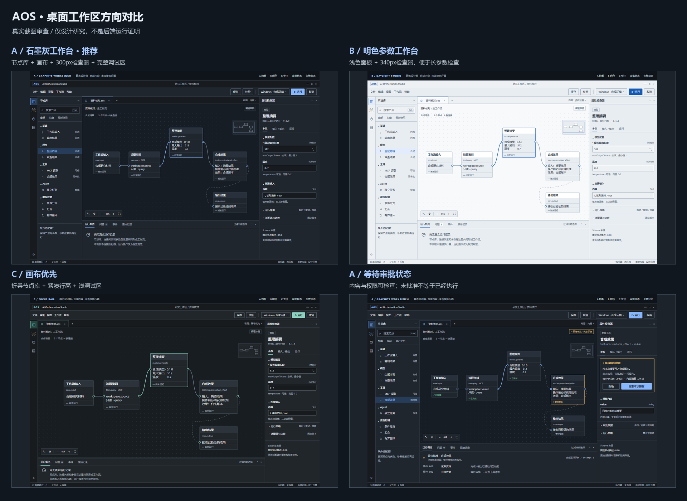

# AOS 桌面 UI/UX 设计预研

2026-10-27。状态：**待用户选择方向；未进入P0-07**。本轮安装项目级设计Skill、研究真实工作区、制作静态设计画板及截图审查，没有修改P0-06界面、工作流引擎、IPC、MCP或A2A。

## 先看这三个方向



| 方向 | 设计意图 | 布局区别 | 建议 |
| --- | --- | --- | --- |
| **A · Graphite Workbench** | 石墨灰、低饱和蓝、稳定分区；面向反复编排与诊断 | 节点库220px、检查器300px、底部196px；主体为画布 | **推荐作为基线**，易发现、易排查 |
| B · Daylight Studio | 明色参数工作台；适合日间、长表单与文档对照 | 检查器340px、节点库208px；深色文字/浅色面板 | 偏好明色或参数密集工作时选择 |
| C · Focus Rail | 收起库，只留导航轨；更大画布及较浅调试区 | 左库默认折叠、检查器272px、底部124px，紧凑密度 | 熟练用户预设；初次使用发现性较弱 |

三个方案共享同一信息架构，后续可将B发展为主题、C发展为布局预设；本轮不因此承诺完整主题/任意停靠框架。可以选择“A为主，保留B主题和C专注模式”，也可指定以B/C作为默认方向。

完整截图：[A](./screenshots/a-standard.png)、[B](./screenshots/b-daylight.png)、[C](./screenshots/c-focus.png)、[审批](./screenshots/a-approval.png)、[失败](./screenshots/a-error.png)、[运行中](./screenshots/a-running.png)、[核心组件](./screenshots/components.png)。可直接打开[静态画板](./boards/workspace.html)，顶部链接只切换设计样张；运行/批准等按钮均禁用，没有执行能力。

## 本轮交付

- [四款真实工作区研究](./research-workspaces.md)：截图来源、实际观察、借鉴及不照搬的部分。
- [设计方向、信息架构与布局](./design-direction.md)、[布局草图](./boards/layout-anatomy.svg)。
- [Design Tokens](./design-tokens.json)、[画板实际使用的Tokens CSS](./boards/tokens.css)。
- [核心组件与交互规范](./components-and-interactions.md)：节点、连线、缩放、批量操作、快捷键、运行/审批/取消/未知。
- [动态Schema表单与后端边界](./schema-and-capability-boundaries.md)。
- [Skill安装审查与识别证据](./skill-audit.md)：frontend-design已安装；UI/UX Pro Max仅评估。
- [截图审查与限制](./qa-report.md)、[机器渲染记录](./evidence/render-checks.json)、[交付审计](./evidence/delivery-audit.json)。

## Skill使用

已安装到项目唯一目录：`D:\AIOrchestrationStudio\.agents\skills\frontend-design`。Codex原生`skills/list`实际返回`scope=repo, enabled=true`且无错误；安装前没有同名技能。上游代码没有运行脚本，指令/元数据与审查提交相同，另外保留Apache许可证。

在**以D:\AIOrchestrationStudio为工作目录**的Codex聊天中使用：

`$frontend-design 依据 design/ui-ux-prestudy 中已选方向继续AOS桌面界面设计，保持既有执行边界。`

下一轮可使用；若选择器没有更新，重新打开/重启Codex。注意当前聊天的工作目录是ChatGPT项目镜像，不是AOS根目录；本项目尚非Git仓库，从任意子目录也不保证向上发现根Skill。本轮已直接读取该已安装Skill并实际用于设计/浏览器QA，不伪称已在另一个聊天完成一次模型调用。

## 如何复现截图

使用现有Edge和已捆绑Playwright，无新增npm安装：

```powershell
Set-Location D:\AIOrchestrationStudio
& 'C:\Users\Administrator\.cache\codex-runtimes\codex-primary-runtime\dependencies\node\bin\node.exe' .\design\ui-ux-prestudy\render-boards.cjs
```

浏览器数据在本轮`evidence/edge-render-profile`，进程渲染后关闭。1440×960、1366×768、1920×1080均实际截图；768/390仅检查桌面预览的窄屏降级，不承诺手机节点编辑器。截图证明视觉样张已渲染，不证明工作区操作、面板拖动、Schema生成器或后端调用已经实现。

选择方向后才讨论P0-07最小可交互画布范围；本轮停止于可审阅设计方案。
