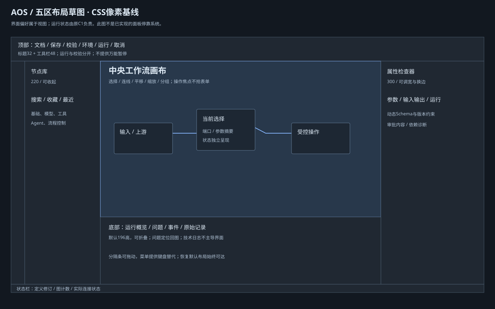

# 设计方向、信息架构与布局

## 产品命题

AOS是本地优先的AI工作流桌面编排工具。用户需要看懂“数据从哪里来、哪些节点能执行、为什么等待/失败、一次操作是否已被批准”，而不是浏览经营指标。视觉主角是节点和连接关系；运行记录是可检索的证据，原始技术日志按需展开。

推荐A：**精密、稳定、可解释的石墨灰工作台**。1px分隔、3px控件圆角、4px节点圆角，蓝色只用于选择/焦点/主要动作。状态使用文字+符号+语义色，不给每种模块刷大面积颜色。没有紫色渐变、装饰动效、卡片仪表盘或营销首屏。

字体有意沿用Windows桌面可读性：Segoe UI Variable Text / Segoe UI，中文Microsoft YaHei UI，数值和版本Consolas。该选择服务于中文参数密度与现有Windows宿主，不套用营销页展示字体。后续字体许可与跨平台替代另核验，不下载在线字体。

## 信息架构

```text
项目工作区
├─ 工作流定义：节点库 → 画布 → 选中节点/边的属性
│  ├─ 参数（配置Schema）
│  ├─ 输入/输出（连接值、类型、来源）
│  └─ 运行策略/适配器版本/依赖诊断
├─ 运行实例：固定定义修订的只读状态投影
│  ├─ 运行概览（当前阻塞、下一步可做的操作）
│  ├─ 问题（定位节点/字段）
│  ├─ 事件（按runId/seq、节点/attempt过滤）
│  └─ 原始记录（显式展开、脱敏）
├─ 审批请求：动作身份、内容、风险、有效期、明确决定
└─ 本机视图偏好：面板宽高/可见性/停靠位置/密度/视口
```

定义、运行实例、外部任务三个上下文不混合。编辑新草稿不改变正在运行的固定修订；历史运行显示“正在查看历史运行”，不让旧结果冒充当前状态。选择节点、画布视口、面板位置属于UI，不能写C1业务终态。

## 默认布局与尺寸



| 区域 | 默认尺寸（CSS px） | 最小/调整范围 | 内容优先级 |
| --- | --- | --- | --- |
| 标题/菜单工具栏 | 32 + 48高 | 按系统窗口缩放，不缩小字体补空间 | 文档、保存、校验、环境、运行/取消 |
| 导航轨 | 40宽 | 固定 | 库、工作流、运行、资源；图标有tooltip/可访问名称 |
| 左节点库 | 220宽 | 184–360，可折叠 | 搜索、收藏、最近、按领域分类；缺适配器保留并诊断 |
| 中央画布 | 剩余空间 | 目标不小于640×360；不足时收起辅助区 | 图、端口、连接、状态；小地图可关闭 |
| 右检查器 | 300宽 | 272–480，可折叠/换边 | 当前选择优先；多选共性参数；空选说明上下文 |
| 底部调试 | 196高 | 96–50%窗口高，可折叠/移到侧边 | 概览→问题→事件→原始记录 |
| 状态栏 | 24高 | 保留关键连接/诊断提示 | 定义修订、计数、执行器连接状态 |

32/48等是设计基线，非冻结Tauri窗口实现。1366×768采用较浅底部区，画布维持可读节点尺寸而不把全部文字自动缩到极小；图超出视口时依赖平移/适应画布，静态样张不实现这项操作。

## 自由布局与密度

面板分隔条视觉1px、鼠标命中6px；拖动时只调整UI布局，释放后保存本机偏好。双击分隔条恢复默认，键盘焦点下方向键每次8px、Shift每次32px。面板标题支持拖到左/右/底部的明确停靠区；Esc取消拖动。提供“视图→移动面板到…”作为非拖拽替代。

第一版建议先实现三固定停靠区内调宽高、折叠/显示、恢复布局，完整任意拆分/浮动窗口保留为设计目标，**尚非后端能力或本轮交付功能**。不能把完整Blender式区域切分直接列为P0-07完成条件。

密度独立于主题：标准表单32px、行30px、正文13px；紧凑28px/26px/12px；后续舒适36px/34px/14px。触屏模式另给≥44px目标，不强迫鼠标桌面每行44px。不能靠浏览器整体缩小字体实现密度。

保存视图偏好使用独立本机view配置；定义布局若未来采用命名扩展须单独版本化并在往返中保留，不能擅自把面板状态放入P0-02可执行语义或C1运行库。显示密度、布局及主题互相可组合。

## 方向选择准则

- A适合默认：节点发现、参数检查、错误定位同时可见；代价是辅助面板占空间。
- B适合长表单：明色边界清楚、Inspector较宽；必须控制大面积亮度，避免强白背景。
- C适合熟练用户：画布更大，但库与运行细节需主动展开；不能作为唯一入口使新用户找不到节点。

建议用户只选默认方向与默认密度，不在没有交互验证前冻结所有尺寸。三者都必须保留面板恢复命令，且等待审批/未知结果不能因为切换布局消失。
