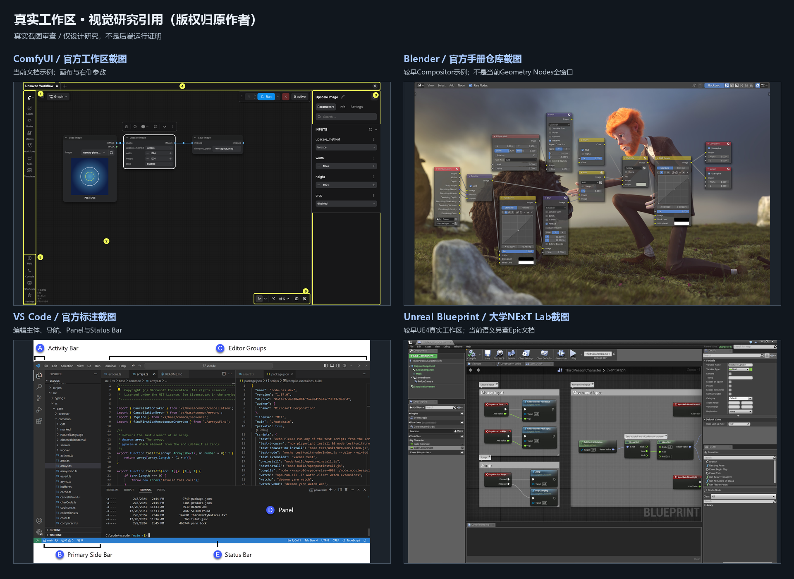

# 真实工作区研究与视觉对比

2026-10-27。观察对象是实际软件截图和一手交互文档；**未在本机安装/运行四款完整工具**。AOS方向是推导方案，不是声称四者功能已移植。

## ComfyUI：画布主导，参数跟随当前选择

依据[官方Interface Overview](https://docs.comfy.org/interface/overview)及页面中的[编号工作区截图](./references/comfy-original.png)。实际看到左侧入口轨、中央连线图、右侧选中节点参数、顶栏运行入口、角落画布控制；节点摘要与Inspector有不同信息密度。

AOS借鉴“画布持续占主体，库/参数围绕它”；不照搬媒体生成App、云账户/credits或瞬时自动排队。AOS的运行操作可能有受控副作用，不能把改参数即自动运行当默认。截图只代表该官方示例，前端版本/模式不同会改变布局。

## Blender节点编辑器：紧凑节点、可读的连接与局部参数

官方[节点编辑器说明](https://docs.blender.org/manual/en/latest/interface/controls/nodes/index.html)及[Geometry Node Editor](https://docs.blender.org/manual/en/latest/editors/geometry_node.html)；文档站本轮正文直取失败，**不声称取得当前完整手册正文**。实际视觉审查使用[Blender官方手册仓库图](https://projects.blender.org/blender/blender-manual/media/branch/main/manual/images/interface_controls_nodes_introduction_example.jpg)，[本地图](./references/blender-workspace.jpg)SHA与Git LFS指针一致。

图中为较早的Compositor示例，能看到紧凑控件、端口、曲线面板和节点连线；不是当前Geometry Nodes全窗口截图。借鉴类型端口、组/折叠、局部编辑密度；不复制其背景合成图或全套3D快捷键。AOS长文本/工具Schema进Inspector，避免所有复杂参数堆进每个节点。

## VS Code：编辑主体、稳定区域、按需调试

依据[官方用户界面](https://code.visualstudio.com/docs/editing/getting-started/userinterface)及[Custom Layout](https://code.visualstudio.com/docs/configure/custom-layout)，实际审查[官方标注截图](./references/vscode-original.png)。左导航/项目区、中间编辑组、底部调试区、状态栏层级清楚；文档支持区域移动和显示控制。

AOS借鉴可恢复布局、命令入口与问题定位，不让终端占据默认主视图，也不把右侧强制设为聊天。AOS的中央编辑对象是图，右侧是节点属性；没有把VS Code全部扩展/浮动窗口能力当作已实现。

## Unreal Blueprint：图、属性与编译问题形成闭环

语义依据Epic官方[UI Components](https://dev.epicgames.com/documentation/en-us/unreal-engine/user-interface-components-in-unreal-engine)与[Compiler Results](https://dev.epicgames.com/documentation/en-us/unreal-engine/compiler-results-in-the-blueprints-visual-scripting-editor-for-unreal-engine)。当前官方页面正文可读，图片接口403，未冒称取得官方当前版本截图。

视觉补充采用墨尔本大学NExT Lab的[Blueprint教学工作区](https://ms-kb.msd.unimelb.edu.au/next-lab/virtual-reality/guides/vr-development-overview/unreal-engine-overview/unreal-engine-primer/interactivity-and-blueprints)，[实际截图](./references/unreal-lab-figure1.png)是较早UE4界面：My Blueprint、中央EventGraph、Details/Palette、Compiler Results均可见，不能冒充UE5.8本机运行。

借鉴“问题→节点定位→属性修改”闭环与上下文搜索；不照搬游戏Compile/Play概念。AOS“校验定义”和“运行工作流”须分开，运行错误也不能自动等同编译错误；执行顺序仍以原契约为准，不添加Blueprint白色执行线的新语义。

## 对AOS的综合取舍

| 观察 | AOS设计决策 |
| --- | --- |
| 四者都让编辑对象保持中心 | 画布优先，不加无关指标卡/经营图表 |
| 左侧发现、右侧当前对象、底部诊断 | 五区布局；可折叠/调宽高，逐步考虑停靠 |
| 高密度不等于所有内容同时展示 | 节点放必要摘要；Inspector放Schema；原始记录按需展开 |
| 连接/选择与问题定位需连贯 | 保留类型文字、可见焦点、问题跳转及多选规则 |
| 各工具快捷键有领域历史 | 借鉴模式，单独设计Windows焦点/冲突范围 |
| 运行反馈必须可信 | UI只投影C1；审批、取消、未知分别表述，不虚构进度/付费模型 |

截图仅保存在研究引用目录并保留出处，版权属于原作者/产品；不作为AOS产品资产。没有完整软件版本、用户任务或可用性访谈数据，不能以这四张图宣称完成用户研究或设计验证。
