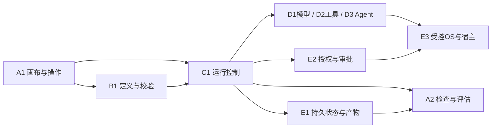

# 模块职责与依赖草案

P0-02继续保留本页10项逻辑职责；新增[架构审查](./p0-02-architecture-review.md)澄清E1/E2/E3交互与代码依赖的区别、秘密管理、统一状态权威、远端Agent审批和SDK重试边界。语言、模块数量和进程仍未冻结。

日期：2026-10-24。**逻辑职责用于讨论，不是冻结的模块数量、名称、接口、进程或语言方案。** 进程如何划分见[开放决策D01/D02](./open-decisions.md)；证据见[资料索引](../research/sources.md)。

## 唯一权威约束（初步设计原则）

- C1独占调度、run/节点状态转换、attempt与恢复决策的逻辑写入权。
- E2独占权限规则、授权grant、人工审批决定和凭据访问政策。
- B1独占可执行定义、节点契约、迁移与图合法性解释。
- E1执行存储与事务，不自行判定节点成功或恢复位置；A2展示与聚合，不修正业务状态。
- E3监督OS进程的启动/退出，不重试业务节点；D适配器报告事实，不自行推进下游。

底层数据库写入可能由统一存储服务执行，但业务写命令必须有唯一拥有者。若选LangGraph/Temporal，框架运行时位于C1边界内，不另建第二个争抢状态的调度器。

## A · 交互与编排

### A1 · 画布、表单与运行操作

- **责任**：节点画布、端口交互、动态参数表单、保存/运行/暂停/取消请求、审批信息呈现。
- **拥有数据**：视口、选择、布局、未保存编辑草稿；正式修订交由B1。
- **对外接口（概念）**：编辑草稿、请求校验/保存、提交运行命令、展示审批。
- **依赖**：B1定义和诊断，C1运行命令/事件，E2审批请求/结果，A2检查视图。
- **不负责**：调度、秘密读取、正式运行状态修改、最终权限判定。
- **依据/待验证**：[S01–S03](../research/sources.md#s01)、[S07](../research/sources.md#s07)；E01动态端口和图往返、E07宿主事件。

### A2 · 运行检查、可观测性与评估

- **责任**：节点输入输出检查、trace关联、usage/成本聚合、样本比较与评估结果展示/导出。
- **拥有数据**：可重建查询投影、评估集及评分记录、价格快照与费用计算来源；原始运行事实归C1。
- **对外接口（概念）**：查询run/attempt视图，提交评估，导出脱敏报告。
- **依赖**：C1事件，D1原始usage，E1产物/记录，E2脱敏与导出政策。
- **不负责**：以遥测代替恢复日志、决定节点成功、直接重试或批准工具。
- **依据/待验证**：[S31/S32](../research/sources.md#s31)；E02计费缺失、E04跨分支追踪、E05重复计数。

## B · 工作流定义

### B1 · 定义、节点注册、校验与迁移

- **责任**：工作流修订、节点描述、参数Schema、数据/控制语义、图校验、迁移及不可变执行快照。
- **拥有数据**：工作流正式修订、节点定义版本、Schema、类型策略和迁移规则。
- **对外接口（概念）**：读取/保存修订，验证并生成计划，查询定义/参数能力，报告迁移差异。
- **依赖**：D1/D2/D3描述快照，E1持久化；可消费E2权限需求预检，但不作最终授权。
- **不负责**：运行调度、读取Key、工具真正执行、运行中状态转换。
- **依据/待验证**：[S06/S16/S46](../research/sources.md#s06)、[S28](../research/sources.md#s28)；E01格式/图校验，E02模型能力变化，E03工具定义变更。

## C · 执行控制

### C1 · 运行控制与状态权威

- **责任**：就绪与派发、并发/汇合/分支/有界循环、attempt/退避、总预算、取消/暂停/恢复、局部重跑和缓存采用决策。
- **拥有数据**：run、节点实例与attempt状态、检查点指针、逻辑操作/幂等标识、事件顺序、输入输出引用和预算预留。
- **对外接口（概念）**：start/pause/resume/cancel/rerun，消费执行结果，发布状态事件，查询运行快照。
- **依赖**：B1不可变计划，E2逐次授权，D适配器执行，E1原子持久化，E3受控执行设施。
- **不负责**：自行批准权限、明文秘密长期保管、解释任意UI布局、创建第二套框架外状态机。
- **依据/待验证**：[S17–S21](../research/sources.md#s17)；E04汇合与重复事件，E05故障窗口，E06审批恢复。

## D · 模型、工具与Agent适配

### D1 · 模型供应商适配

- **责任**：能力描述、消息/参数映射、生成/流解析、结束原因与usage/错误归一化；一次请求内重试按C1明确预算执行。
- **拥有数据**：供应商/模型/API版本能力快照、映射规则、临时请求关联；不拥有run状态。
- **对外接口（概念）**：describe/generate/stream/cancel及usage报告。
- **依赖**：E2凭据政策，E3安全凭据注入/网络设施，E1可选产物写入；调用上下文来自C1。
- **不负责**：执行模型提议的工具调用、分支调度、节点级重试与预算总账。
- **依据/待验证**：[S22–S27](../research/sources.md#s22)；E02两家真实供应商差异和取消。

### D2 · 工具适配

- **责任**：MCP/HTTP/CLI描述发现、版本协商、输入输出校验、单次调用和错误报告。
- **拥有数据**：工具描述快照、连接/会话、协议请求与结果关联。
- **对外接口（概念）**：discover/describe/invoke/cancel/close。
- **依赖**：E2授权凭据，E3进程/网络边界，B1契约校验规则，E1产物。
- **不负责**：信任工具自报安全、批准工具、绕过C1自行重试副作用或派发下游。
- **依据/待验证**：[S28/S29](../research/sources.md#s28)、[S41](../research/sources.md#s41)、[S44/S45](../research/sources.md#s44)；E03/E06/E07。

### D3 · 独立Agent任务适配

- **责任**：Agent能力发现、提交/查询/取消、输入请求与产物映射，保留远端任务生命周期。
- **拥有数据**：Agent Card/协议版本快照、远端任务ID、会话恢复引用；本地节点状态归C1。
- **对外接口（概念）**：describe/submit/query/continue/cancel及状态通知。
- **依赖**：E2身份/授权，E3网络设施，E1产物；C1接收远端事实后决定本地状态。
- **不负责**：假定远端任务等同模型函数、保证远端取消、让远端Agent直接修改本地运行库。
- **依据/待验证**：[S30](../research/sources.md#s30)；固定A2A规范/SDK和独立互操作实验尚缺，是否进入初版开放。

## E · 本地基础设施及安全

### E1 · 存储与产物服务

- **责任**：持久化事务、事件/检查点写入设施、产物寻址/摘要/保留、备份与损坏诊断。
- **拥有数据**：物理数据库/文件、索引与存储元信息；业务记录的逻辑归属仍由上游模块定义。
- **对外接口（概念）**：按拥有者提交事务、读快照、存取产物引用、检查完整性。
- **依赖**：E3受控文件/OS设施，E2访问与保留政策。
- **不负责**：决定run终态、调度任务、解释模型费用或自行恢复业务。
- **依据/待验证**：[S21](../research/sources.md#s21)；E05事务/产物一致性、E07单写者与分发目录。

### E2 · 策略、授权与审批

- **责任**：权限策略、grant、人工审批、密钥访问政策、日志/导出脱敏政策；在每次执行入口给出可审计决定。
- **拥有数据**：策略版本、审批请求/决定、授权范围、secretRef元数据；OS密文由E3设施保管。
- **对外接口（概念）**：authorize、request/resolveApproval、撤销/过期、授权凭据访问、脱敏策略查询。
- **依赖**：E1审计持久化，E3身份/凭据OS机制；A1仅提供用户输入渠道。
- **不负责**：调度节点、代模型判意图、把Prompt要求当作强制机制、自己执行CLI。
- **依据/待验证**：[S29](../research/sources.md#s29)、[S33–S38](../research/sources.md#s33)；E06绕过与篡改、E07边界执行。

### E3 · 桌面宿主与受控系统能力

- **责任**：Tauri窗口/IPC边界、执行进程生命周期、凭据OS读写、文件/网络/进程限制的机制落实、分发与关闭协调。
- **拥有数据**：进程句柄、IPC会话、宿主配置、OS凭据命名空间与受控资源句柄。
- **对外接口（概念）**：启动/停止执行进程、受限文件/网络/进程操作、按授权解析secretRef、宿主退出事件。
- **依赖**：E2授权决定；正常关闭与C1协调持久暂停；必要元数据经E1保存。
- **不负责**：自行批准权限、业务节点调度/恢复、把独立进程当安全沙箱。
- **依据/待验证**：[S34–S41](../research/sources.md#s34)；E07打包/进程树/离线启动，E06真实强制边界。

## 主依赖与一次调用路径

此图表示主要交互，非严格DAG模块依赖图。启动时E3承载C1所在进程；正常关闭时C1向E3报告可退出状态。

典型调用：A1请求 → B1固定定义并校验 → C1创建run/确定待执行节点 → E2校验当前操作并要求必要审批 → C1向D派发受限上下文 → D经E3落实OS限制/凭据注入并报告事实 → C1经E1持久化权威结果 → A2形成视图。E2拒绝则C1记录阻断，不让D先执行后补审批。

## 当前仍需收敛

逻辑职责是否合并、运行控制所在语言、框架检查点如何映射E1、D3是否进入初版、权限令牌与进程边界机制均未定。通过E01–E07后按变化频率、故障边界和部署成本调整，避免按文档标题机械拆成十个微服务。

